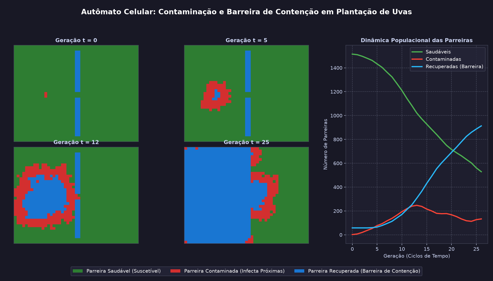

# 🍇 Autômato Celular: Plantação de Uvas e Barreira de Contenção

Simulação em Python utilizando **Autômatos Celulares bidimensionais** (inspirado no modelo epidemiológico espacial SIR) para demonstrar a propagação de uma praga/patógeno entre **parreiras de uva**, seguida pela **recuperação das parreiras**, que passam a atuar como **barreira de contenção** protegendo o restante do vinhedo.



---

## 🧠 Como Funciona o Autômato

Cada célula da grade $(i, j)$ representa uma **parreira de uva** que pode assumir um dos seguintes estados discretos:

| Estado | Código | Cor / Símbolo | Comportamento na Simulação |
| :--- | :---: | :---: | :--- |
| **Saudável** | `1` | 🟢 Verde (`🍇`) | Parreira produtiva e suscetível a ser contaminada por parreiras vizinhas infectadas. |
| **Contaminada** | `2` | 🔴 Vermelho (`🦠`) | Parreira infectada que transmite a praga para as parreiras próximas com probabilidade $p$ por vizinho infectado. |
| **Recuperada (Barreira)** | `3` | 🔵 Azul (`🛡️`) | Após cumprir o ciclo de infecção (`tempo_recuperacao`), a parreira se recupera, torna-se imune e **atua como barreira física/biológica de contenção**, bloqueando o avanço da praga. |

### Regras de Transição ($t \rightarrow t + 1$)

1. **Contágio entre Parreiras Próximas:**
   Uma parreira **Saudável** avalia suas vizinhas na vizinhança de Moore (8 parreiras próximas). Se houver $k > 0$ parreiras vizinhas **Contaminadas**, a probabilidade de contaminação no passo atual é dada por:
   $$P(\text{contaminar}) = 1 - (1 - p)^k$$
2. **Recuperação e Formação de Barreira:**
   Uma parreira **Contaminada** permanece transmitindo por $T_{\text{rec}}$ gerações. Ao atingir $T_{\text{rec}}$, ela se recupera e transita para o estado **Recuperada / Barreira de Contenção**.
3. **Efeito de Contenção:**
   Parreiras no estado **Recuperada / Barreira** não voltam a se infectar e não transmitem a praga, formando cinturões ou anéis de isolamento que protegem as parreiras saudáveis adjacentes.

---

## 🚀 Como Executar

### 1. Interface Gráfica Interativa (Tkinter)
Execute o arquivo principal sem argumentos para abrir o simulador interativo com controle de probabilidade, tempo de recuperação, cenários e desenho de barreiras com o mouse:

```bash
python automato_uvas.py
```

### 2. Modo Terminal (CLI)
Para visualizar o autômato rodando diretamente no terminal passo a passo:

```bash
python automato_uvas.py --cli
```

### 3. Animação Científica e Geração de Gráficos (Matplotlib)
Para abrir a animação com curvas populacionais ao vivo ou exportar o painel `evolucao_plantacao_uvas.png`:

```bash
# Abrir animação interativa
python simulacao_matplotlib.py

# Gerar painel PNG com estágios da simulação
python simulacao_matplotlib.py --salvar-imagem
```

---

## 📦 Requisitos

- Python 3.10+
- `matplotlib` e `numpy` (opcionais, apenas para `simulacao_matplotlib.py`; a interface principal `automato_uvas.py` utiliza apenas bibliotecas nativas do Python: `tkinter`).

```bash
pip install -r requirements.txt
```
